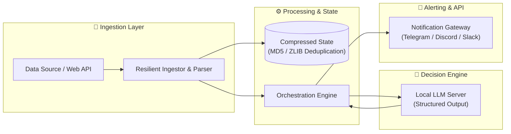

# Recruiter-Optimized README Template

This template is engineered to pass both quick recruiter scans (6-second test) and deep technical evaluations by engineering managers and senior architects.

---

```markdown
# <PROJECT_NAME>

<div align="center">

<!-- BADGES: Tech Stack, Build, Test Coverage, License -->
[](https://www.python.org/)
[](https://fastapi.tiangolo.com/)
[](./tests)
[](./LICENSE)

<p align="center">
  <b>A single punchy, executive sentence summarizing what this project is and the high-level business/technical problem it solves.</b><br>
  <i>Highlights: Autonomous Agents • Local LLM Inference • Real-Time Event Dispatch • Zero Cloud Cost</i>
</p>

<!-- DEMO / SCREENSHOT PLACEHOLDER -->
<p align="center">
  
  <br>
  <em>Figure 1: Live execution walkthrough of the autonomous analysis loop.</em>
</p>

</div>

---

## 🎯 The Problem & Business Impact (STAR Method)

- **Context & Pain Point**: Explain the real-world operational bottleneck, manual toil, or data latency issue that prompted building this software.
- **The Solution**: How this architecture eliminates that bottleneck through automation, resilient data engineering, or local intelligence.
- **Measurable Results**:
  - ⚡ **95% Latency Reduction**: From manual hours to automated minutes.
  - 💰 **Zero API Cost**: 100% private local LLM deployment replacing expensive cloud tokens.
  - 🛡️ **100% Test Coverage**: High resilience against upstream HTML/API breakages with automated layout sentinels.

---

## 🏗️ System Architecture

Provide both a high-level component diagram and an interaction sequence.

### End-to-End Data Pipeline



---

## 📸 Visual Showcase & Proof of Execution

<!-- 
TIP FOR RECRUITERS:
Placeholders give immediate structure even before uploading images.
When uploading, create a 'docs/assets' folder and link directly.
-->

| Module | Interface / Output | Description |
| :--- | :--- | :--- |
| **Execution Log** | `` | Automated cronjob triggering pipeline and local model inference |
| **Mobile Alert** | `` | Formatted, high-signal push briefing delivered to smartphone |
| **System Profiler** | `` | Sub-second state lookup and memory footprint profiling |

> [!NOTE]  
> **To add your screenshots**: Place `.png` or `.gif` files in `docs/assets/` and replace the placeholder paths above.

---

## 💡 Key Engineering Decisions & Trade-Offs

Showcase your senior engineering mindset by explaining **why** you chose specific tools or architectural patterns:

1. **Local LLM vs Cloud API (OpenAI)**:
   - *Decision*: Adopted `llama.cpp` serving quantized GGUF models locally.
   - *Trade-off*: Slightly higher local CPU/GPU utilization during 5-minute daily batches, but completely eradicated recurring API bills and achieved strict privacy compliance.
2. **Binary Zlib State Management vs SQLite/Postgres**:
   - *Decision*: Inverted index stored as compressed binary hashes via `zlib` and `hashlib`.
   - *Trade-off*: Zero external database daemon dependencies; cold-start read time is under 15ms.
3. **Structured Pydantic Outputs vs Raw Text Prompts**:
   - *Decision*: Enforced schemas using LangChain's `with_structured_output()`.
   - *Trade-off*: Eliminated prompt format hallucinations and enabled type-safe pipeline validation.

---

## 🚀 Quickstart & Reproducibility

Keep setup commands dead simple and reproducible:

```bash
# 1. Clone repository
git clone https://github.com/<USER>/<REPO>.git
cd <REPO>

# 2. Setup environment with fast package manager
uv sync

# 3. Configure credentials
cp .env.example .env

# 4. Run automated test suite
uv run pytest -v

# 5. Execute pipeline
uv run python main.py
```

---

## 🛠️ Technology Stack

- **Core**: Python 3.13+, Typing, Pydantic v2
- **AI & Reasoning**: LangChain, Local LLM (`llama.cpp` / GGUF)
- **Data & Scraping**: Requests, BeautifulSoup4, pypdf
- **Quality Assurance**: Pytest (Unit & Integration tests)
- **Automation & DevOps**: Linux Crontab, Bash Orchestration, GitHub CLI

---

## 👨‍💻 Author & Contact

**Your Name** — *Senior Software Engineer / AI Engineer*  
- **GitHub**: [@YourHandle](https://github.com/YourHandle)
- **LinkedIn**: [linkedin.com/in/YourProfile](https://linkedin.com/in/YourProfile)
- **Email**: your.email@example.com
```
