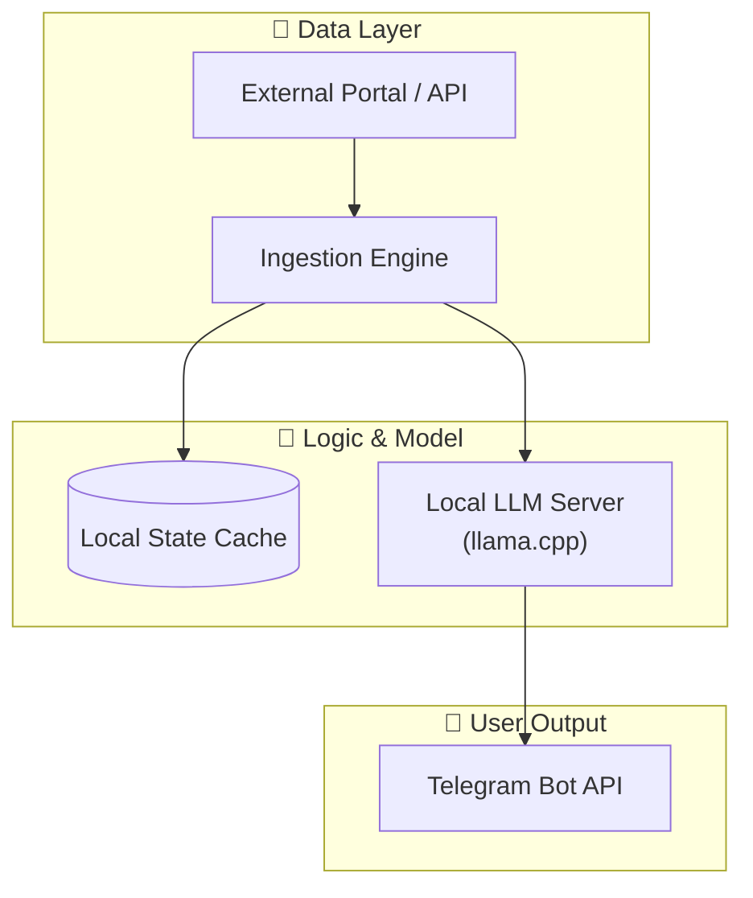

# Visual Assets & Placeholder Guide

Recruiters spend an average of 6–10 seconds glancing at a GitHub repository before deciding whether to read deeper or contact the candidate. Clear visuals, badges, diagrams, and structured screenshot placeholders immediately establish professional polish.

---

## 🛡️ 1. Dynamic Shields.io Badges

Place these directly under the main `# Title` in a centered `<div>`:

```markdown
<div align="center">

[](https://www.python.org/)
[](https://www.langchain.com/)
[](https://docs.pydantic.dev/)
[](./tests)
[](./LICENSE)

</div>
```

---

## 🖼️ 2. Formatting Image & Demo Placeholders

When screenshots or demo recordings are not ready yet, **never leave a blank gap**. Use styled HTML placeholder callouts that make it effortless to drop images in later.

### Pattern A: Hero Showcase Placeholder (Centered with shadow)

```markdown
<div align="center">
  
  <p><i>📸 <b>Demo Placeholder</b>: Replace with screen recording (GIF/MP4) showing the bot executing and streaming Telegram alerts.</i></p>
</div>
```

### Pattern B: Multi-Screenshot Gallery Table

```markdown
| 📲 Mobile Notification | 💻 Terminal Execution & Local LLM |
| :---: | :---: |
|  |  |
| *Real-time executive briefing on Telegram* | *Autonomous batch run via `llama.cpp`* |
```

---

## 📊 3. Mermaid Diagram Best Practices for GitHub

GitHub natively renders Mermaid code fences (` ```mermaid `). Follow these rules to avoid parsing failures:

1. **Always wrap node text with double quotes `["..."]`** whenever text contains parentheses, slashes, colons, or punctuation.
2. **Never put bare pipe characters (`|`) inside node text.** Use `<br/>` for line breaks and `/` or `or` instead of `|`.
3. **Use subgraphs to separate architectural concerns**:
   - `Ingestion` / `Sensors`
   - `Storage` / `State`
   - `Reasoning` / `LLM`
   - `Output` / `Delivery`

### Example:



---

## 🚀 4. How to Host & Upload Assets to GitHub

1. **In-Repo Directory (Recommended for Portfolios)**:
   ```bash
   mkdir -p docs/assets
   # Copy your screenshots here:
   # cp /path/to/screenshot.png docs/assets/demo.png
   # git add docs/assets && git commit -m "docs: add demo screenshots"
   ```
2. **Direct Markdown Embedding**:
   Reference with relative paths: ``.
   This ensures images render offline, in GitHub web, and across forks.
