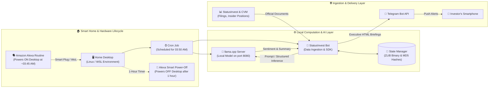

# 📊 StatusInvest AI Bot & Private Python SDK

<div align="center">


<p align="center">
  <b>An autonomous ecosystem for B3 market intelligence (Stocks and REITs / FIIs).</b><br>
  Acts as a <i>24/7 Investment Analyst</i>: intercepts official CVM Material Facts and Shareholding Changes (Insider Trading), parses PDF/HTML reports, summarizes and classifies sentiment with Local AI, and dispatches smart alerts via Telegram.
</p>

</div>

---

## 💡 About the Project

The Brazilian financial market generates hundreds of regulatory filings, Material Facts, market announcements, and shareholding updates daily. Tracking this volume of information manually is impractical for individual investors and analysts.

This project addresses this challenge with a modular two-layer architecture:
1. **Private SDK (`statusinvest_sdk`)**: A typed, resilient Python library for collecting fundamental data, official announcements, and corporate ownership changes from the StatusInvest platform via internal endpoints and advanced web scraping.
2. **Autonomous AI Bot (`bot.py`)**: A continuous monitoring agent leveraging **LangChain** with **local LLMs** (OpenAI-compatible via `llama.cpp` or `LM Studio`) to analyze documents with zero cloud API costs and 100% privacy.

---

## 🏗️ System Architecture

The project operates on an automated, energy-efficient IoT & AI infrastructure. It combines smart home automation (Amazon Alexa), scheduled local inference (`llama.cpp`), and event-driven data ingestion from StatusInvest/CVM to deliver real-time market intelligence directly to Telegram while keeping standby power consumption and cloud costs at zero.

### 🌐 End-to-End Infrastructure & IoT Lifecycle



#### Step-by-Step Architecture Walkthrough

1. **Smart Boot (Amazon Alexa)**: An automated Alexa routine turns on the user's home desktop workstation at approximately 03:45 AM using a smart plug or Wake-on-LAN (WoL), preparing the environment before market data processing.
2. **Scheduled Trigger (03:50 AM Cronjob)**: A Linux cron job triggers at **03:50 AM**, orchestrating the startup of the local `llama.cpp` HTTP server with the configured quantized model.
3. **Data Ingestion & Deduplication**: The bot (`bot.py`) connects to the StatusInvest platform and CVM to scrape Material Facts, corporate notices, and Insider Trading / Shareholding positions for all monitored assets. It checks unique MD5 event hashes against the compressed binary store (`data/state.zlib`).
4. **Local LLM Inference**: For every new filing or stake change, raw text is fed to `llama.cpp` via LangChain's structured output. The local model evaluates market implications, extracts financial figures, and classifies sentiment (`Positive`, `Neutral`, `Negative`) without sending proprietary data to external cloud providers.
5. **Instant Telegram Alerts**: Analysis results are formatted into rich HTML notifications and dispatched via the Telegram Bot API directly to the investor's mobile phone.
6. **Automatic Shutdown (Alexa 1-Hour Timer)**: Exactly 1 hour after turning on (around 04:45 AM), the Alexa smart routine safely turns off the desktop computer, eliminating standby power consumption until the next scheduled run.

### 🧩 Software Pipeline & Data Flow

```mermaid
flowchart TD
    subgraph Ingestion ["📡 Data Ingestion Layer"]
        SI[StatusInvest Portal / CVM]
        API[StatusInvest Internal API\nBatch JSON]
        SCRAP[BeautifulSoup Scraper\nDynamic HTML]
        SI --> API
        SI --> SCRAP
    end

    subgraph Detection ["⚡ Processing & Deduplication"]
        CLIENT[StatusInvestClient]
        INSIDER[InsiderScraper\nShareholding Positions]
        STATE[(StateManager\nZLIB Binary Memory\nMD5 Hashes)]
        
        API --> CLIENT
        SCRAP --> CLIENT
        SCRAP --> INSIDER
        
        CLIENT -->|New Documents| STATE
        INSIDER -->|New Movements| STATE
    end

    subgraph Intelligence ["🧠 Artificial Intelligence Layer"]
        EXTRACT[Document Extractor\nPDF: pypdf | HTML: bs4]
        LLM[LangChain + Local LLM\nllama.cpp / Ollama / LM Studio]
        PYDANTIC[Pydantic Structured Output\nSentiment + Executive Summary]
        
        STATE -->|Unseen Events| EXTRACT
        EXTRACT --> LLM
        LLM --> PYDANTIC
    end

    subgraph Delivery ["📲 Notification & Alerts"]
        TELEGRAM[TelegramNotifier\nHTML Formatted Messages]
        FILE[FileNotifier\nLocal Debug Logs]
        SENTINEL[Layout Sentinel\nPageLayoutChangedError]
        
        PYDANTIC --> TELEGRAM
        PYDANTIC --> FILE
        SCRAP -.->|Selector Failure| SENTINEL
        SENTINEL -.-> TELEGRAM
    end
```

---

## ✨ Key Features

- **⚡ Hybrid StatusInvest Access**:
  - *Fast Path*: Direct queries to the internal advanced search API (CategoryType 1 for Stocks, 2 for FIIs) with multi-fundamental parsing (P/E, P/VP, DY, Price).
  - *Resilient Scraping*: Deep extraction via `BeautifulSoup` on individual asset pages with flexible selector fallbacks.
- **🦈 Insider Trading & Ownership Tracker**:
  - Extracts official data on major shareholders, board of directors, and controlling entities.
  - Generates fingerprints based on shareholder name, percentage, and share count to alert on meaningful stake changes.
- **🧠 Local AI Analysis (LangChain + Pydantic)**:
  - Integration via OpenAI-compatible protocol with local models (`llama.cpp`, `LM Studio`, `Ollama`).
  - Strict enforcement via `with_structured_output(SentimentAnalysis)` producing:
    - **Context** of the event.
    - **Key Highlights** (numbers, corporate decisions, financial amounts).
    - **Impacts** on the asset and investor.
    - **Sentiment** categorically classified: `Positive`, `Neutral`, or `Negative`.
- **📄 Intelligent Document Reader**:
  - Downloads regulatory filings and natively reads CVM PDFs using `pypdf`.
  - Automatic fallback to HTML/FNET pages when announcements are dynamic web forms.
- **💾 Compressed Persistent State (BJSON)**:
  - Deduplication via **MD5** event hashes.
  - Pydantic serialization compressed to binary via **`zlib`**, guaranteeing microscopic disk footprint and zero redundant LLM inference costs.
- **🛡️ Layout Change Sentinel**:
  - Proactive `PageLayoutChangedError` triggering Telegram alerts if the portal modifies its HTML DOM, preventing silent scraping failures.
- **🔌 Dependency Injection**:
  - Clean architecture with `Notifier` abstraction (`TelegramNotifier`, `FileNotifier`), simplifying custom adapters for Discord, Slack, or Webhooks.

---

## 📁 Repository Structure

```text
investidor/
├── bot.py                     # Autonomous bot orchestrator
├── pyproject.toml             # Project & dependency management (uv/pip)
├── .env.example               # Environment variables template
├── automacao_plano.md         # Architecture & scheduling documentation
├── project_summary.md         # Detailed engineering modules overview
├── data/
│   └── state.zlib             # Compact binary state database (git-ignored)
├── logs/                      # Log files and debug outputs
├── tests/
│   └── test_sdk.py            # Automated test suite with Pytest
└── statusinvest_sdk/          # Core SDK Python package
    ├── __init__.py            # Main public exports
    ├── client.py              # StatusInvestClient (Internal API + scraping fallback)
    ├── parser.py              # StatusInvestParser (BeautifulSoup & DOM selectors)
    ├── insider.py             # InsiderScraper (Shareholding & Controllers)
    ├── ai_analyzer.py         # AIAnalyzer (LangChain + Pydantic Structured Output)
    ├── storage.py             # StateManager (Binary persistence with zlib)
    ├── notifier.py            # Notifier interface, TelegramNotifier & FileNotifier
    ├── exceptions.py          # Custom exceptions & layout sentinel
    ├── logger.py              # Structured logging configuration
    ├── config.py              # Safe .env loading
    └── models/
        ├── ticker.py          # AcaoModel and FiiModel (Pydantic)
        ├── report.py          # ReportModel (Pydantic)
        └── state.py           # ProcessedState (Pydantic)
```

---

## 🚀 Getting Started

### Prerequisites
- **Python 3.13+**
- [`uv`](https://github.com/astral-sh/uv) package manager (recommended) or `pip`
- Telegram Bot Token (obtained from [@BotFather](https://t.me/botfather))
- Optional local LLM server (e.g., LM Studio on port `8080` or Ollama)

### 1. Clone and Install

```bash
# Clone the repository
git clone git@github.com:MigueldsBatista/investidor.git
cd investidor

# Create virtual environment and sync dependencies with uv
uv sync

# Or with traditional pip:
# python -m venv .venv && source .venv/bin/activate
# pip install -e .
```

### 2. Configure Environment Variables

Copy the example file and fill in your credentials:

```bash
cp .env.example .env
```

Edit `.env`:

```env
# Telegram
TELEGRAM_BOT_TOKEN="123456789:ABCdefGhIJKlmNoPQRsTUVwxyZ"
TELEGRAM_CHAT_ID="123456789"

# Monitored Assets
ATIVOS_MONITORADOS="PETR4,TAEE11,XPML11,VALE3,ITUB4"

# Local LLM Server (OpenAI API-compatible)
OPENAI_API_BASE="http://localhost:8080/v1"
OPENAI_API_KEY="not-needed"
OPENAI_MODEL_NAME="local-model"
LOG_LEVEL="INFO"
```

### 3. Run the Bot

```bash
uv run python bot.py
```

---

## 💻 Code Examples

The SDK was designed to be imported and used independently of the bot across any quantitative finance or data analysis Python project.

### 1. Batch Fundamental Screening

StatusInvest's internal API allows fetching hundreds of assets in fractions of a second:

```python
from statusinvest_sdk import StatusInvestClient

client = StatusInvestClient()

# 1. Batch fetch all B3 stocks
stocks = client.get_acoes_indicadores()
print(f"Total mapped stocks: {len(stocks)}")

# Filter dividend opportunities with attractive P/E
opportunities = [
    stock for stock in stocks
    if stock.dy and stock.dy >= 8.0 
    and stock.p_l and 0 < stock.p_l <= 8.0
]

for stock in opportunities[:5]:
    print(f"[{stock.ticker}] Price: R${stock.price:.2f} | DY: {stock.dy:.2f}% | P/E: {stock.p_l:.2f}")

# 2. Query individual REIT (FII) with automatic fallback
fii = client.get_fii("XPML11")
print(f"\nFII: {fii.ticker} - {fii.company_name}")
print(f"Price: R${fii.price:.2f} | P/VP: {fii.p_vp} | DY: {fii.dy}%")
```

---

### 2. Regulatory Filings & CVM Announcements Extraction

Retrieve official CVM reports with direct download links:

```python
from statusinvest_sdk import StatusInvestClient

client = StatusInvestClient()

# Extract reports, filings, and material facts
filings = client.get_reports("PETR4")

for doc in filings[:5]:
    print(f"📅 Date: {doc.date}")
    print(f"🏷️ Category: {doc.category}")
    print(f"📝 Description: {doc.description}")
    print(f"🔗 CVM URL: {doc.download_url}")
    print("-" * 50)
```

---

### 3. Insider Trading & Ownership Monitoring

Identify purchases, sales, and stake adjustments by controlling shareholders and directors:

```python
from statusinvest_sdk.insider import InsiderScraper

scraper = InsiderScraper()
positions = scraper.get_posicao_acionaria("TAEE11")

for pos in positions:
    print(f"Shareholder: {pos['acionista']}")
    print(f"Controller: {'Yes' if pos['controlador'] == 'sim' else 'No'}")
    print(f"Stake: {pos['percentual']}% ({pos['quantidade']} shares)")
    print(f"Last CVM Update: {pos['data_alteracao']}")
    print(f"MD5 Hash: {pos['hash']}\n")
```

---

### 4. Document Analysis with Local LLM & Structured Output

The analyzer leverages `LangChain` with the Pydantic `SentimentAnalysis` model, guaranteeing structural consistency without format hallucinations:

```python
from statusinvest_sdk.ai_analyzer import AIAnalyzer

# Initialize client pointing to local LLM server (e.g., llama.cpp / LM Studio)
analyzer = AIAnalyzer(
    base_url="http://localhost:8080/v1",
    model_name="mistral-7b-instruct"
)

announcement_text = """
TAESA informs its shareholders and the market that the Board of Directors
approved the distribution of interim dividends totaling R$ 250,000,000.00,
equivalent to R$ 0.72 per common and preferred share. Payment will occur
on December 20, 2026, based on the shareholding position of December 10.
"""

result = analyzer.analyze_document(
    ticker="TAEE11",
    categoria="Notice to Shareholders",
    conteudo=announcement_text
)

print(f"📊 Sentiment: {result.sentimento}")
print(f"📝 Executive Summary:\n{result.explicacao}")
```

---

### 5. Telegram Notifications with Layout Sentinel

The SDK supports dependency injection of `Notifier`. If StatusInvest updates its HTML layout, you receive an instant alert on Telegram detailing the broken selector:

```python
from statusinvest_sdk.client import StatusInvestClient
from statusinvest_sdk.notifier import TelegramNotifier

notifier = TelegramNotifier(
    token="YOUR_TELEGRAM_TOKEN",
    chat_id="YOUR_CHAT_ID"
)

# Injecting notifier into client:
client = StatusInvestClient(notifier=notifier)

# If a site card changes class, the client dispatches a technical alert on Telegram:
# ⚠️ [SDK CRITICAL] Layout Change
# Asset: PETR4 | Failed Field: p/vp | Attempted Selector: div.info/item...
```

---

## 🧪 Automated Testing

The project includes a comprehensive test suite powered by `pytest`, covering internal API requests, Pydantic models, individual scraping, and report parsing.

To run all tests:

```bash
uv run pytest -v
```

Expected output:

```text
tests/test_sdk.py::test_get_acoes_indicadores PASSED                    [ 12%]
tests/test_sdk.py::test_get_fiis_indicadores PASSED                     [ 25%]
tests/test_sdk.py::test_get_fii_individual_api PASSED                   [ 37%]
tests/test_sdk.py::test_get_fii_individual_scraping PASSED              [ 50%]
tests/test_sdk.py::test_get_acao_individual_api PASSED                  [ 62%]
tests/test_sdk.py::test_get_acao_individual_scraping PASSED             [ 75%]
tests/test_sdk.py::test_get_reports_fii PASSED                          [ 87%]
tests/test_sdk.py::test_get_reports_acao PASSED                         [100%]

============================== 8 passed in ~5s ==============================
```

---

## ⚙️ Environment Variables

| Variable | Type | Default | Description |
| :--- | :--- | :--- | :--- |
| `TELEGRAM_BOT_TOKEN` | `string` | `""` | Telegram Bot API authentication token |
| `TELEGRAM_CHAT_ID` | `string` | `""` | Target Chat ID for analysis and alerts |
| `ATIVOS_MONITORADOS` | `string` | `"PETR4,TAEE11,XPML11"` | Comma-separated list of B3 tickers |
| `OPENAI_API_BASE` | `string` | `"http://localhost:8080/v1"` | Base URL for OpenAI-compatible API (e.g., `llama.cpp`) |
| `OPENAI_API_KEY` | `string` | `"not-needed"` | API key for AI endpoint |
| `OPENAI_MODEL_NAME` | `string` | `""` | Model name loaded in local server |
| `LOG_LEVEL` | `string` | `"INFO"` | Log detail level (`DEBUG`, `INFO`, `WARNING`, `ERROR`) |

---

## ⏰ Automation & Periodic Execution

The entire system is orchestrated around a nightly **03:50 AM** automated run, coordinated between Amazon Alexa (hardware power management) and a Linux `crontab` schedule:

```cron
# 03:50 AM (Mon-Fri): Starts llama.cpp, runs bot.py, dispatches Telegram alerts, and saves state
50 3 * * 1-5 cd /home/miguel/workspace/investidor && ./pipeline.sh >> logs/cron.log 2>&1
```

### Automation Timeline

| Time | Component | Action |
| :--- | :--- | :--- |
| **~03:45 AM** | 🗣️ Amazon Alexa | Powers ON desktop workstation via Smart Plug or Wake-on-LAN |
| **03:50 AM** | ⏰ Cron Job | Launches `pipeline.sh` (initializes `llama.cpp` and starts `bot.py`) |
| **03:51 AM** | 🤖 StatusInvest Bot | Scrapes CVM filings, insider trading data, and checks MD5 state |
| **03:53 AM** | 🦙 llama.cpp | Performs local inference with structured output (sentiment + summary) |
| **03:55 AM** | 📲 Telegram API | Delivers formatted mobile notifications to the investor |
| **~04:45 AM** | 🔌 Amazon Alexa | Powers OFF desktop workstation (after 1-hour active window) |

See [automacao_plano.md](automacao_plano.md) for orchestrator script details (`pipeline.sh`).

---

## 🛠️ Tech Stack

- **Language**: Python 3.13+
- **AI Framework**: [LangChain](https://www.langchain.com/) & `langchain-openai`
- **Data Validation**: [Pydantic v2](https://docs.pydantic.dev/)
- **Web Scraping & HTTP**: [BeautifulSoup4](https://www.crummy.com/software/BeautifulSoup/), [Requests](https://requests.readthedocs.io/)
- **Document Processing**: [pypdf](https://pypdf.readthedocs.io/)
- **Optimized Storage**: `zlib` & `hashlib` (BJSON state management)
- **Messaging**: Telegram Bot API
- **Package Manager**: [uv](https://github.com/astral-sh/uv)
- **Testing**: [pytest](https://docs.pytest.org/)

---

## 👨‍💻 Author

Developed by **Miguel Batista**  
- **GitHub**: [@MigueldsBatista](https://github.com/MigueldsBatista)
- **Email**: msb2@cesar.school

---

## 📄 License

This project is licensed under the [MIT](LICENSE) License.
